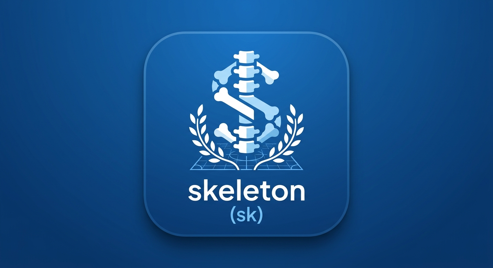

# **skeleton (sk)**

skeleton (sk) is a fast, zero-dependency CLI tool written in Go that instantly bootstraps modern, production-ready Python project repositories.  
It embeds all required configurations (uv, ruff, bandit, pytest, Docker, Makefiles, Pre-commit, and GitHub Actions) directly into a single compiled binary.

## **⚡ Features**

> * 📦 **Single Static Binary**: No runtime dependencies or template folder management required.  
> * 🐍 **Modern Python Stack**: Configured with [uv](https://github.com/astral-sh/uv) for lightning-fast package management.  
> * 🛡️ **Built-in Quality Controls**: Out-of-the-box linting, formatting, and security audits with ruff, bandit, and pre-commit.  
> * 🐳 **Container Ready**: Chainguard-based multi-stage Dockerfile included.  
> * 🚀 **CI/CD Built-in**: Pre-configured GitHub Actions for CI/CD container builds and GitHub Pages deployment.

## **🚀 Quick Start**

### **Installation**

#### **Building from Source**

```
git clone https://github.com/  
cd skeleton  
make install
```

#### **Manual Binary Installation**

> 1. Download the latest binary for your operating system from the [Releases](https://github.com/yourusername/skeleton/releases) page.  
> 2. Move the binary into your executable path and create a symlink for skeleton:
  ```
  sudo mv sk /usr/local/bin/sk  
  sudo chmod +x /usr/local/bin/sk  
  sudo ln -sf /usr/local/bin/sk /usr/local/bin/skeleton
  ```
## **💻 Usage**

To create a new project, run sk init or skeleton init followed by your desired project name:
```
sk init my_python_project
```

### **Generated Project Structure**

```
my_python_project/  
├── .env                          # Local environment variables draft  
├── .github/  
│   └── workflows/  
│       ├── ci.yaml               # GitHub Actions CI/CD workflow  
│       └── webpage.yaml          # GitHub Pages deployment workflow  
├── .pre-commit-config.yaml       # Pre-commit hook definitions  
├── Dockerfile                    # Production multi-stage Dockerfile  
├── Makefile                      # Standardized project tasks  
├── pyproject.toml                # Dependencies, ruff & bandit configuration  
├── assets/                       # Static media or data files  
├── src/  
│   └── main.py                   # Main application entry point  
├── tests/  
│   └── test_main.py              # Pytest placeholder  
└── website/                      # Frontend / Documentation website root
```

## **🛠️ Generated Project Workflow**

Inside any generated project, you can instantly use the included Makefile shortcuts:  
```
cd my_python_project

# Install dependencies with uv  
make deps

# Format code (ruff format + check --fix)  
make format

# Run linter and security scans (ruff + bandit)  
make lint

# Run test suite  
make test

# Build Scan and run Docker container locally  
make docker-build
make docker-scan
make docker-run
```

## **🔧 CLI Tool Development**

### **Requirements**

> * [Go](https://go.dev/) 1.22 or higher

### **Local Commands**

```
# Compile local binary to ./bin/sk  
make build

# Install binary locally to /usr/local/bin  
make install

# Run unit tests  
make test

# Clean build directory  
make clean
```

### **Releasing a New Version**

Releases are automatically built and published across platforms (Linux, macOS, Windows) via GitHub Actions and GoReleaser upon pushing a semver tag:

```
git tag -a v1.0.0 -m "Release v1.0.0"  
git push origin v1.0.0
```

## **📄 License**

MIT License. See [LICENSE](http://docs.google.com/LICENSE) for details.
